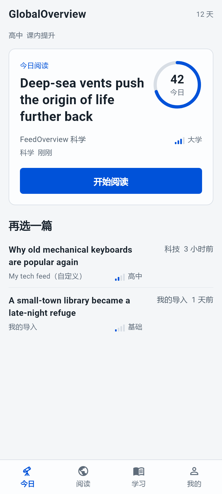
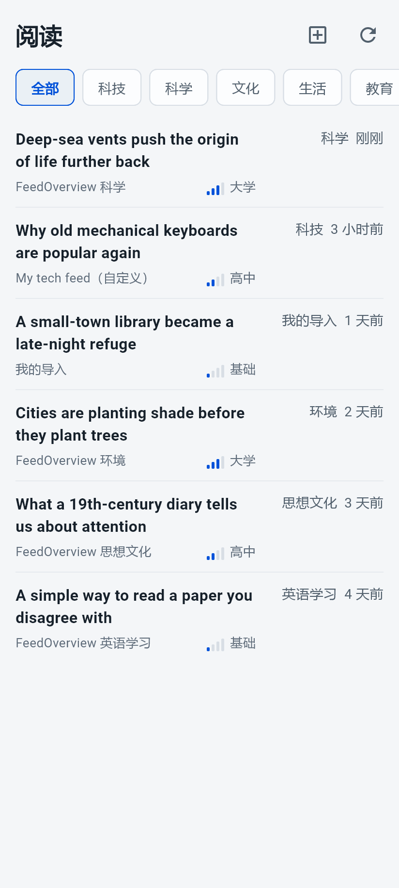
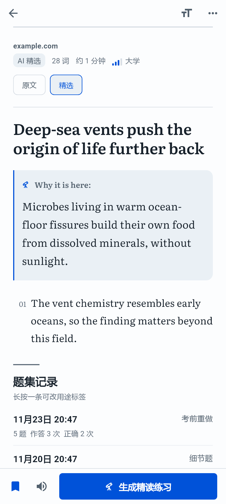
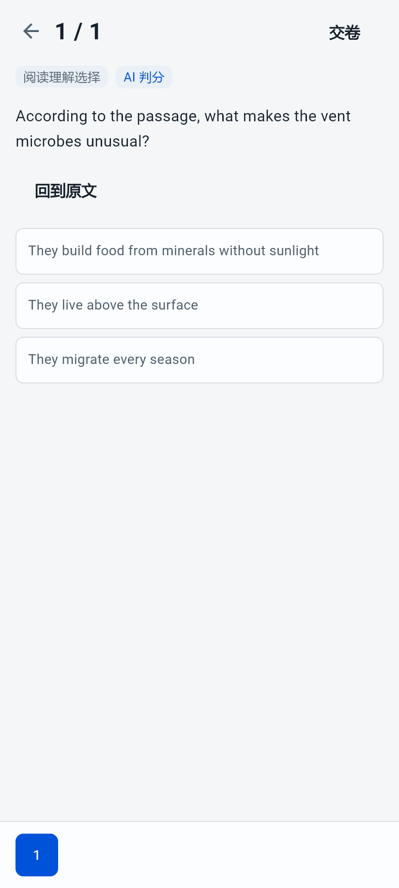
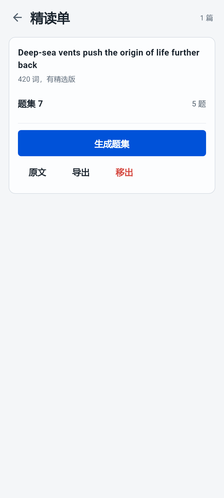
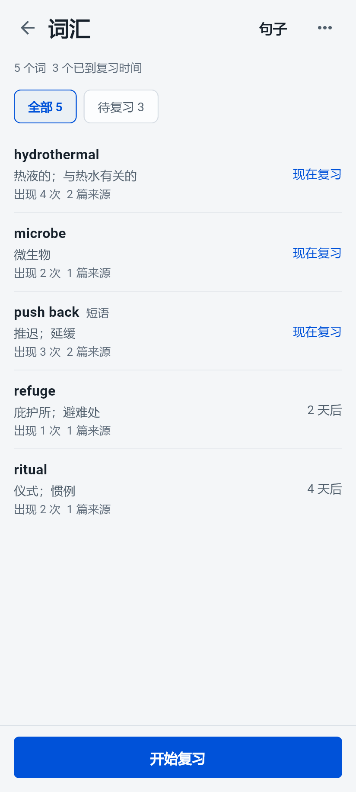
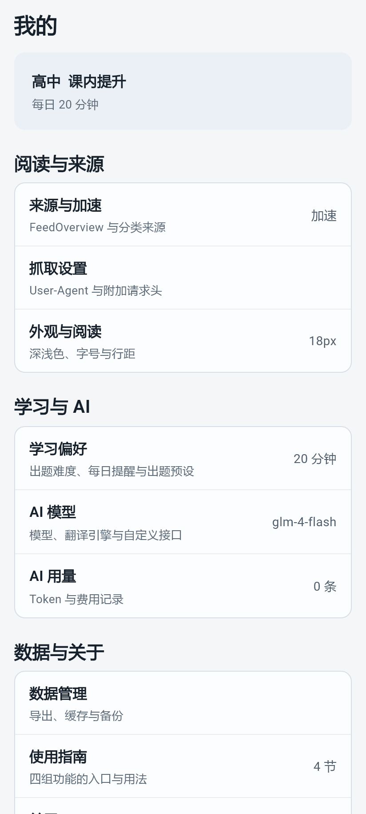
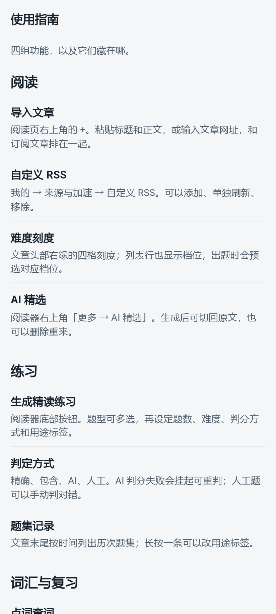

<div align="center">


<h1>GlobalOverview</h1>

<p>
  一个<b>没有账号、没有服务端</b>的英语时文阅读与练习 App。<br/>
  生词、题集、作答与配置只存本机；文章、AI 与朗读请求直连你选择的服务商。
</p>

<p>
  <a href="LICENSE"></a>
  
  
  
  
  <a href="https://none-ptr.github.io/GlobalOverview/app/"></a>
</p>



</div>

---

## 它是什么

- **读**：内置 86 个 RSS 源、17 个分类，首次启动订阅 15 个；也可以粘贴正文、输入文章网址，或添加自己的 RSS 源。
- **练**：13 种题型，按题型多选出题；精确、包含、AI、人工四种判定方式，答完即判，题集留档。
- **记**：点词查词进入生词本，错题自动归集，连续天数与每日目标驱动「今日阅读」。

不需要账号，没有服务端。文章与 AI 请求需要联网；生词、题集、作答与配置只写在本机 SQLite 与 Keystore 里。具体的出网点见[网络去向](#网络去向)。

---

## 在线体验（Web 版）

同一套 Flutter 代码也能编译成 Web，直接在浏览器里运行：**[none-ptr.github.io/GlobalOverview/app](https://none-ptr.github.io/GlobalOverview/app/)**。

- 数据存在浏览器的 IndexedDB（`sqflite_common_ffi_web`），不离开设备；没有账号，也没有服务端。
- 导出走浏览器下载，系统分享 / 打印取决于浏览器支持，后台通知不适用。
- 首次打开会拉取文章与字体，建议在桌面或较新版本的手机浏览器上体验。

---

## 界面预览

| 学习首页 | 阅读列表 | 沉浸式阅读器 |
| :---: | :---: | :---: |
|  |  |  |

| 点词查词 | 答题 | 精读单 |
| :---: | :---: | :---: |
|  |  |  |

| 词汇与复习 | 我的 | 使用指南 |
| :---: | :---: | :---: |
|  |  |  |

截图由 widget 测试生成，不是设计稿：

```bash
$env:README_SHOTS=1; flutter test test/v4_readme_shots_test.dart --update-goldens
```

---

## 说在前面

> 又到了假期，不知为何每次放假后，紧绷的弦突然松开时，我都会感到空虚，上学时如果明明要我说去玩什么的话我能说出一大串来，但放了假后明明有时间玩了，而我却什么连想玩什么都不知道了。
>
> 既然不知道玩什么，那就写点题吧，指尖划过屏幕，在 pdd 上敲下“英语时文阅读”几个字。随之出现在眼前的，不是软件图标，而是一堆数字。
>
> 我愣了一下，想起了那些发黄的纸币。或许，在我身后柜子里还有几张，十几张那样的纸币。可是，那又够我在求学路上支撑多久呢？
>
> 突然有一天我的朋友找到我问我这个暑假还写项目吗，此时，我看到了一束光。那束光，是家中台式电脑电源按钮的微光，我好似看到了希望。
>
> 我想起了我的项目，想起了我在上上个寒假开发 `OJ` 的日日夜夜，想起了我与朋友一同开发的日子。我觉得忏悔，为什么面对忙碌而又空虚的假期，我没有早点想起我还能继续开发，可能是因为我已经上课上麻木了吧。
>
> 受 [ReadYou](https://github.com/ReadYouApp/ReadYou) 等 `RSS` 阅读器的启发，一个大胆的念头出现在我的脑海之中，我要自己手搓一个英语时文阅读器。于是我连忙拉上了一位英语更不好的英语课代表一起，准备这项伟大的工程。
>
> 完全的免费，完全的自由，完全的希望！不，是取之不尽的，用之不竭的！
>
> 这次，我的手指在触感真实而又熟悉的黑色键盘上，回味着往事。在经过漫长的开发和调试之后，在我几乎想要放弃之际，终于我看到了方向。
>
> 那里，有一座望远镜，和一个地球。
>
> 紧接着，一系列的文章，星罗棋布，或许是望远镜观察到的吧。轻点做题，有选择，填空，简答。作答时虚无缥缈的手机屏幕键盘也好似有了力量，闪烁着，跳跃着，好似希望的火苗。
>
> 平时阅读时，我便会轻点屏幕，那些晦涩难懂的短语、单词的释义便会跃然屏幕上，加入单词本中供我积累。
>
> 此时，窗外正是一半晴一半阴。
>
> “朝晖夕阴，气象万千。”我不禁吟诵道，看着眼前的另一轮朝阳照亮了英语之路，我隐隐地笑了。
>
> 以上，致我的一个暑假。
>
> 本人拙笔，请见谅。

> [!NOTE]
> 本项目最初基于 `uni-app`（`Vue3` + `Vite`）实现，源码保留在 [`legacy/`](legacy) 目录，仅作历史留档。**当前版本已用 Flutter + Dart 完全重写**，界面与交互都重新实现了一遍，仅在业务流程和视觉语言上延续了原版的设计。

> [!NOTE]
> 本项目的界面与业务实现基本由 `LLM` 辅助完成，本人主要负责提出需求、验证结果和反复调教。参考过 [ReadYou](https://github.com/ReadYouApp/ReadYou) 等开源项目的功能设计。

---

## 功能

### 阅读与来源

- **内置目录**：86 个 RSS 源、17 个分类（新闻、科学、健康、科技、商业、环境、食物、艺术、设计、书籍文学、思想文化、英语学习、体育、旅行、教育、政策智库、生活）。
- **导入自己的内容**：阅读页右上角「+」，粘贴标题与正文，或输入文章网址；导入内容与订阅文章一起排序，来源标为「我的导入」。
- **自定义 RSS**：在我的 → 来源与加速里添加、单独刷新、移除订阅源。
- **抓取保护**：内置浏览器式 User-Agent，可覆盖并附加请求头；403 / 429 / 超时会被识别并给出可重试提示，付费墙与拦截页不入库。
- **难度刻度**：FeedOverview 条目带 0–100 难度，映射为基础 / 高中 / 大学 / 进阶四档，阅读器与列表都显示刻度。

### 阅读器

- 字号、行距可调并本地记忆；首段作为「Why it is here」的题记排版，正文带边栏序号。
- 点词查词、长按取句、选择多词整段翻译；正文插图按屏宽解码并缓存到本地。
- **AI 精选**：右上角「更多 → AI 精选」，把长文读短，可随时切回原文、重新精选或删除；出题优先使用精选版。
- **朗读**：Edge TTS 在线合成 mp3 后本地播放，音色、语速、语调可调，支持全文 / 选句 / 单词。

### 练习

- 精读单里选预设或临时设置：题型（可多选）、题数、难度、判定方式、用途标签。
- 13 种题型：完形填空、阅读理解选择、语法填空、信息匹配、判断正误、句子排序、概要写作、英译中、中译英、词汇运用、短语填空、句子改写、开放性问答。
- 一屏一题、左右滑动，底部题号跳转；交卷后按模式判分，每题给出解析与**原文出处**。
- 人工题可手动判对错；AI 判分失败会挂起为待判，可重判。
- 文章末尾保留题集记录，长按可改用途标签。

### 词汇、复习与数据

- 生词本记录出现次数与出处，支持 AI 按主题整理，FSRS 简化复习调度。
- 错题本支持重判与全部重做。
- 导出 PDF、导出备份、清缓存；AI 用量按次记账（本机）。
- 首次运行提供五步引导；老用户首次进入会看到一次功能说明，之后可从「我的 → 使用指南」回看。

---

## 网络去向

没有账号、没有官方服务端，但阅读与 AI 本身是联网请求。下面这些是唯一的出网点：

| 去向 | 发送内容 | 时机 |
|---|---|---|
| FeedOverview（`none-ptr.github.io`） | 只请求 `feed.xml` 与分类源，不上传学习数据 | 同步、刷新文章 |
| RSS 源、文章站点、图片 CDN | 订阅地址、文章 URL、图片 URL | 抓取列表、打开文章、加载配图 |
| LLM 服务 | 系统提示词、正文（最多 12000 字符）、你的补充要求 | 出题、判分、精选、句子拆解、词汇整理 |
| 翻译接口 | 被翻译的词或句子 | 点词查词、整句或全文翻译 |
| `edge.text-to-speech.cn` | 要朗读的全文或选句 | 朗读 |
| GitHub Releases | 只下载新版 APK | 检查更新 |

**不会离开设备**：生词本、题集、作答、错题、学习进度、API key 与全部设置。

第三方能看到的是 IP、请求时间与目标 URL；LLM、翻译与朗读服务还会看到你发送的文本本身。内置模型使用共享额度，请求由维护者的 key 发出；换成自己的模型后，文本只发往你填写的服务。

---

## 技术栈

- `Flutter 3.50` / `Dart 3.14`，Android 为主，另有 Web 版
- `Riverpod 3`（Provider + Notifier 变更信号）
- `sqflite`（本地库，schema 版本 8，含 v6–v8 的增量迁移）
- `http` / `xml` / `html`（抓取、RSS 解析、正文抽取）
- `audioplayers`（Edge TTS 合成后播放）
- `printing` + `pdf`（导出）
- `shared_preferences` + `flutter_secure_storage`（配置与密钥）
- `TDesign Flutter`（基础控件），视觉层包在自建 token 上

设计 token 在 `lib/v4/theme/v4_tokens.dart`（`V4Palette` / `V4Type` / `V4Space`），组件在 `lib/v4/widgets/`，页面只做组合。所有 LLM 提示词集中在 `lib/services/prompts.dart`。

---

## 项目结构

```text
lib/
  main.dart                    入口与启动流程
  services/                    抓取、RSS、抽取、LLM、判分、词汇、导出、TTS、更新…
  v4/
    app_bootstrap.dart         启动分层：迁移 / 首启 / 主界面
    screens/                   27 个页面（阅读、阅读器、答题、精读单、词汇、指南…）
    services/                  文章仓库、出题、导入、难度、成本、迁移…
    theme/                     V4 token 与深浅主题
    widgets/                   索引行、难度刻度、各类弹层与卡片
test/                          70+ 测试文件，含布局扫描、无障碍与截图用例
legacy/                        旧版 uni-app + Vue3 源码（仅作历史留档）
assets/                        图标、字体（Literata、Noto Sans SC）、世界地图 GeoJSON
web/                           Flutter Web 外壳（含 sqflite_sw.js、sqlite3.wasm）
docs/                          落地页与 README 截图（GitHub Pages 站点根）
.github/workflows/             Pages 自动部署
```

---

## 开发

环境：Flutter 3.50（stable）、Android SDK、JDK 17。

```bash
flutter pub get
flutter run
flutter test
flutter analyze
flutter build apk --release
flutter build web --release --base-href /GlobalOverview/app/
```

几点说明：

- `applicationId` 为 `com.github.overviewsoftware.globaloverview`（Android）；Web 版运行在浏览器里，无此概念。
- debug 与 release 复用 `legacy/key.jks` 同一套签名，新版可直接覆盖安装，用户数据不丢。
- 朗读依赖在线接口，离线不可用；失败时提示「这台设备暂时无法朗读」。
- LLM 的 api key 只存在本机；首次使用到「我的 → AI 模型」配置并测试连通性。
- 写界面时不要给可能放大的文字套固定高度，系统字号放大后会被裁切；布局扫描测试覆盖了 320px 宽与 2 倍字号。

---

## 部署（GitHub Pages）

Web 版通过 GitHub Actions 自动发布：push 到 `main` 时，`.github/workflows/pages.yml` 会构建 Web 并部署。站点结构是「落地页在根、Web 应用在 `/app/`」，两者共用同一个 Pages。

- **一次性设置**：仓库 Settings → Pages → Build and deployment → Source 选 **GitHub Actions**（否则 workflow 不会发布）。
- **本地预览**：

```bash
flutter build web --release --base-href /GlobalOverview/app/
# 用任意静态服务器指向 build/web，例如：
python -m http.server -d build/web 8080
```

生成物约 55MB（CanvasKit 与内置中文字体占大头），所以不把 `build/web` 提交进仓库，交给 CI 构建。

---

## 已知边界

- **平台**：以 Android 为主，另有 Web 版（数据存浏览器 IndexedDB）；iOS 未适配。
- **AI 精选不保留配图**：输出契约只保留段落。
- **老数据难度为空**：难度在抓取时写入，旧文章需重新打开才会补上。
- **没有跨设备同步**：数据只在本机，换机需要导出备份。

---

## TODO

1. iOS 适配
2. AI 精选保留配图
3. 长文章首帧的分段布局
4. 错题 / 单词与复习计划联动
5. 文章过滤：按关键词、来源、时间
6. 更准的离线词库：音标、词频与释义来源

## 致谢

感谢所有贡献者，特别感谢 ShaDouBuShi123 提供的图标与支持；感谢 [43aquarius](https://github.com/43aquarius) 和 [HMUG12](https://github.com/HMUG12) 的贡献。

QQ 交流群：1103837727
