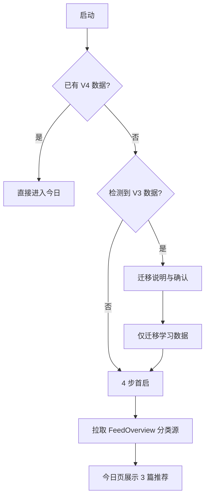
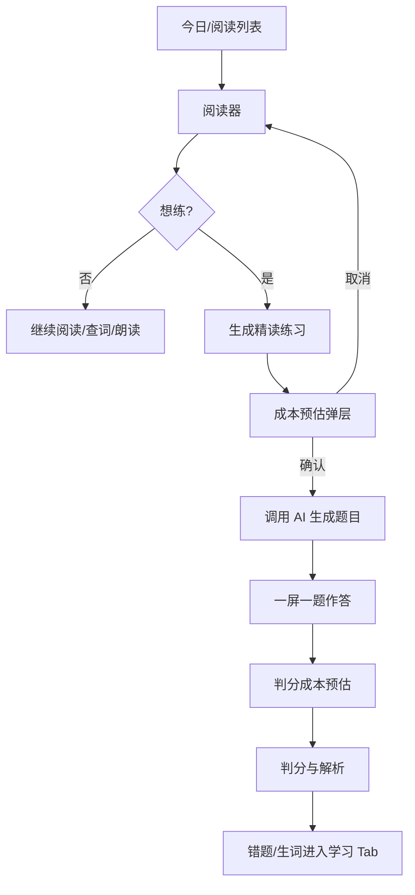
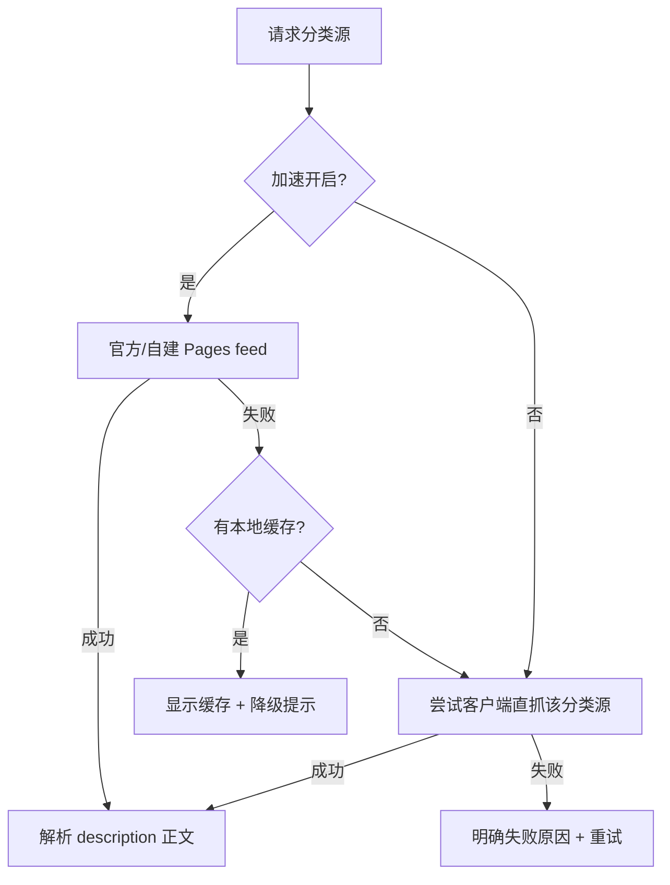

# GlobalOverview V4 产品设计文档

- 版本：v4.0 设计稿
- 日期：2026-11-23
- 目标平台：Android（首版）
- 文档定位：产品定义 + 信息架构 + 关键流程 + 交互规范 + 技术方案约束 + 验收标准

---

## 1. 结论摘要

V4 不是 V3 的换皮，而是一次以“**打开就能读，读后自然练，练前知道花多少钱**”为核心的重构。

V3 的主要问题是入口复杂、功能平铺、深色重装饰削弱阅读、AI 成本不可见。V4 的解决方式是：

1. **阅读优先**：首启不再要求配置模型、订阅源或出题预设，10 秒内进入第一篇适合自己水平的文章。
2. **多水平分层**：首启选择水平、目标和兴趣，内容、难度、题型与释义语言随之适配。
3. **FeedOverview 加速**：默认使用官方聚合 RSS，解决客户端直抓不稳定的问题；可关闭、可自建、可回退直抓，不引入账号或用户数据上传。
4. **TDesign 重构**：浅色阅读优先，TDesign 规范统一组件与交互；望远镜/地球弱化为品牌点缀，不再作为正文背景。
5. **AI 成本透明**：任何 AI 调用前显示 Token 与金额区间；有价格表时估算金额，没有时明确“无法估算金额”，调用后展示实际用量账本。
6. **只迁学习数据**：升级保留生词、例句、题集、作答与错题；不保留文章内容、订阅配置和模型密钥。

V4 的一句话定位：

> 一个本地存储学习数据、按水平推荐英语时文、在出题前把 AI 成本说清楚的沉浸式阅读器。

---

## 2. 已确认的设计决策

| 决策项 | V4 结论 |
|---|---|
| 核心用户 | 多水平分层的英语学习者，通过首启选择水平与目标来分流 |
| 产品重心 | 阅读优先，AI 按需辅助；模型配置延后 |
| FeedOverview | 作为“内容加速层”，默认开启；允许关闭和自建；不得违背“完全本地”原则 |
| AI 成本 | 展示 Token 与金额区间；有单价才算钱；调用后展示实际 usage |
| 首版范围 | 完全重新设计，允许删除旧功能与添加新功能 |
| 视觉 | 浅色阅读优先，TDesign 组件体系，支持深色 |
| 数据迁移 | 只保留学习数据，不保留内容、源配置与模型配置 |
| 平台 | 首版仅 Android |

### 2.1 “完全本地”的准确口径

“完全本地”指：

- 无账号、无云端学习档案；
- 生词、笔记、题集、作答、错题、打卡、偏好、API Key 均保存在本机；
- 客户端不向 FeedOverview 上传任何用户学习数据；
- AI 请求由客户端直接发往用户选择的模型服务，不经过项目方中转。

它**不等于**文章内容完全离线。V3 本来就需要联网获取 RSS 和原文；V4 的 FeedOverview 同样只是公共内容的预处理器与分发器。产品文案应写成：

> 无账号，数据不离开你的手机；文章和 AI 服务需要联网。

---

## 3. 现状诊断

### 3.1 V3 能力盘点

V3 已有较完整的功能基础：

- 86 个 RSS 源、17 个分类、正文抽取、AI 精选、点词查词、TTS；
- 13 种题型、出题预设、答题、AI 判分、错题本；
- 单词本、复习评分、打卡、15 枚徽章；
- PDF 导出、自定义模型、自定义翻译接口、应用内更新；
- Flutter 3.47 / Riverpod 3 / sqflite，已有较完整的测试。

问题不在“功能不够”，而在**概念太多、路径太长、成本不可见、视觉不鼓励阅读**。

### 3.2 三大核心问题

| 问题 | 具体表现 | V4 对策 |
|---|---|---|
| 上手难 | 首启面对源、模型、预设、题型、目标等概念；点词/查词/出题路径分散 | 4 步首启、阅读优先、AI 延后配置、智能默认值 |
| UI 不想用 | 深紫色地球背景占据大面积，卡片与按钮层级接近，文字密度高 | TDesign 浅色体系、纸张感正文、减少装饰、明确主 CTA |
| 出题不敢用 | 点击“生成题集”前不知道会发送多少正文、消耗多少 Token、花多少钱 | 成本预估 BottomSheet + usage 账本 + 本地预算保护 |

### 3.3 V4 不做的事

- 不做账号、云同步、社区；
- 不在首版支持 iOS/Web；
- 不要求用户部署 FeedOverview 才能使用；
- 不承诺任何模型价格长期准确；
- 不把“免费模型”宣传成绝对零成本或无限制。

---

## 4. 用户与场景

### 4.1 分层模型

首次启动收集四项信息，全部可跳过：

| 维度 | 选项 | 影响 |
|---|---|---|
| 当前水平 | 基础 / 高中 / 大学 / 进阶 | 推荐难度、默认题型、释义深度 |
| 学习目标 | 课内提升 / 四六级 / 考研 / 雅思托福 / 兴趣阅读 | 题型权重、解析语言、目标文案 |
| 兴趣主题 | 17 个分类中最多选 5 个，默认 5 个 | 今日推荐与阅读页默认 Tab |
| 每日投入 | 10 / 20 / 30 分钟 | 首页任务数量与阅读卡片长度 |

### 4.2 核心用户旅程

1. 打开 App，4 步首启，不要求模型配置。
2. 首页出现 3 篇按水平与兴趣推荐的文章，每篇显示来源、难度、阅读时长、推荐理由。
3. 打开文章即可读；点词查词、长按取句，生词自动进入学习数据。
4. 想练时点击“生成精读练习”，先看到成本预估，再确认调用 AI。
5. 答完后本地/AI 判分，错题进入“学习”；次日首页出现待复习和精读提醒。

### 4.3 默认路径的关键原则

- 首屏永远有可读内容，不出现“请先配置模型”。
- 主操作每屏只有一个：今日读第一篇 / 生成练习 / 开始复习。
- 高级设置藏在“我的”，不在阅读与练习路径中打断用户。

---

## 5. 信息架构

### 5.1 一级导航：4 个 Tab

| Tab | 定位 | 主要内容 |
|---|---|---|
| 今日 | 每天的入口 | 今日精读、3 篇推荐、连续天数、下一步学习动作 |
| 阅读 | 内容发现 | 主题 Tab、搜索、来源筛选、文章列表、加速状态 |
| 学习 | 学习资产 | 待复习、精读单、错题本三个分区 |
| 我的 | 设置与说明 | 水平目标、来源与加速、AI 与成本、数据、关于 |

V3 的“计划”Tab 被取消；出题不再从“加入计划 → 选预设 → 生成题集”开始，而改为从文章或今日卡片直接进入。

### 5.2 二级页面

| 页面 | 进入方式 | 说明 |
|---|---|---|
| 阅读器 | 阅读列表 / 今日卡片 | 沉浸式正文、点词、朗读、版本切换、生成练习 |
| 精读练习 | 阅读器 / 学习 Tab | 一屏一题、原文对照、交卷 |
| 成本预估弹层 | 任一 AI 操作前 | Token、金额区间、发送内容、确认 |
| AI 用量账本 | 我的 → AI 与成本 | 调用记录、实际 usage、累计费用 |
| 来源管理 | 我的 → 来源与加速 | 加速开关、官方/自建/直抓、分类订阅 |
| 模型配置 | 我的 → AI 与成本 | base URL、Key、模型名、连通性测试 |
| 数据管理 | 我的 → 数据 | 学习数据导出、备份、清理 |

### 5.3 V3 → V4 概念映射

| V3 概念 | V4 处理 |
|---|---|
| 出题计划 | 取消；改为文章派生的“精读单” |
| 出题预设 | 取消；改为按水平/目标的智能默认 + 单次“调整出题” |
| 13 种题型 | 收敛为 6 种核心题型；高级题型仅保留定义，不在 V4 首屏暴露 |
| 成就徽章 | 取消 15 枚徽章；保留连续天数与每日目标 |
| AI 精选 | FeedOverview 已完成精简；客户端精选降为高级手动操作 |
| 自定义 UA/请求头 | 移入高级来源设置 |
| 自定义翻译 API | 移入高级设置 |
| PDF 导出 | 收进阅读器“分享/打印”菜单 |
| 地球动效 | 从正文背景移除，仅用于启动/空状态点缀 |

---

## 6. V4 功能定义

### 6.1 P0：首版必须具备

#### A. 首启分层

- 4 步选择：水平、目标、兴趣、每日投入。
- 可跳过；默认值：高中 / 课内提升 / 5 个通用兴趣 / 20 分钟。
- 完成后立即拉取已启用内容，不进入配置页。
- 首次进入显示一次“无账号、数据本地”说明，可关闭。

#### B. 今日

- “今日精读”主卡：1 篇最匹配的文章，显示预计阅读时间与难度。
- “再看两篇”：2 篇备选。
- 进度条：今日阅读 0/1、复习 0/N、精读 0/1。
- 推荐理由用自然语言说明，例如“符合你的高中水平 · 科技主题 · 8 分钟”。
- 无内容时的空状态说明来源状态，而不是空白页。

#### C. 阅读发现

- 主题 Tab：用户选择的 5 个主题置前，其余可展开。
- 列表卡片字段：标题、来源、相对时间、难度、词数/阅读分钟、来源类型。
- 操作：加入精读单、打开、更多。
- 搜索：按标题、来源、正文关键词本地筛选。
- 筛选：难度、时间、来源类型（加速 / 直抓 / 自建）。

#### D. 沉浸式阅读器

- 正文默认浅色纸张风格：背景近白，正文深色，行距舒适。
- 字号、行距、主题在阅读器设置中调整，结果本地记忆。
- 点词：底部词卡显示释义、发音、上下文例句、加入生词本。
- 长按：取句/翻译。
- TTS：全文、选句、单词卡。
- 版本切换：精简版 / 原文字样明确；加速源默认展示精简版，可打开原文链接。
- 底部主 CTA：生成精读练习；次级操作：查词、朗读、分享。

#### E. 精读练习

- 从文章直接生成，无需计划和预设。
- 默认 5 题；可在成本页上方“调整出题”修改题量、题型、解析语言。
- 6 种核心题型：

| 题型 | 适用水平 |
|---|---|
| 细节理解选择 | 全水平 |
| 主旨大意选择 | 高中及以上 |
| 词义猜测 | 全水平 |
| 推理判断 | 高中及以上 |
| 语法填空 | 基础 / 高中 |
| 翻译或概要写作 | 大学 / 进阶 |

- 一屏一题，左右滑动；题号条可跳转；“回到原文”浮层可对照。
- 交卷前显示判分成本预估；主观题使用 AI 判分，客观题优先本地判分。
- 结果页展示答案、解析、原文证据；错题进入学习 Tab。

#### F. 学习与复习

三个分区：

1. **待复习**：基于现有复习状态，显示今日到期生词；支持“忘记 / 模糊 / 记得”。
2. **精读单**：已加入的文章及生成过的练习；支持再次练习、移除。
3. **错题本**：按文章或题型分组；支持重做和查看解析。

#### G. AI 成本透明

- 所有 AI 操作（出题、判分、客户端精选、长句翻译）统一走成本预估。
- 预估内容：模型名、输入 Token、最大输出 Token、金额区间、是否返回 usage。
- 调用后记录实际 usage 与费用。
- 详见第 9 节。

#### H. FeedOverview 加速

- 默认开启。
- 用户可关闭，回到客户端直抓；也可填写自建 Pages 地址。
- 状态可见、失败可降级，详见第 8 节。

### 6.2 P1：首版不做但保留设计位置

- 自定义训练计划；
- 高级题型（句子排序、信息匹配、句子改写等）；
- 15 枚成就徽章与等级体系；
- Web/iOS 适配；
- 跨设备同步；
- 社区和共享题集。

### 6.3 P2：新增加的能力

- 今日推荐理由：让用户理解“为什么给我这篇”。
- AI 成本账本：把每次调用的 Token 与金额留在本地。
- 精简版/原文切换：明确区分 FeedOverview 加工内容与原文。
- 本地预算保护：可设置每日 AI 支出软上限。
- 重复生成缓存：相同模型+提示+参数在 24 小时内可复用本地结果。

---

## 7. 关键流程

### 7.1 首启流程



首启不出现：模型 Key、base URL、FeedOverview 部署、题型、预设。

### 7.2 阅读到练习流程



### 7.3 FeedOverview 降级流程



---

## 8. FeedOverview 接入方案

### 8.1 接入定位

FeedOverview 是 RSS 生产者，不是客户端 SDK。V4 只需订阅其标准 RSS 2.0 文件：

- 合并源：`.../feed.xml`
- 分类源：`.../feeds/<key>.xml`，共 17 个分类
- 官方/自建地址通过配置提供，发布前替换为实际 Pages 根地址

README 明确说明其对 GlobalOverview 客户端代码无侵入：标准 RSS 2.0 字段包括 `title`、`link`、`description`、`pubDate`、`guid`、`source`。

### 8.2 内容处理规则

| 字段 | V4 使用方式 |
|---|---|
| `title` | 文章标题，保留原文 |
| `link` / `guid` | 原文永久链接，作为去重主键与“打开原文”入口 |
| `pubDate` | 列表时间与排序 |
| `source` | 来源展示名 |
| `category` | 映射到阅读页主题 Tab |
| `description` | 解析其中 HTML，得到 AI 精简正文、推荐理由、难度提示 |

注意：FeedOverview 的 `description` 以 `【AI 精简版】` 开头，内容是**删减后的原文句子**，不是客户端 AI 生成的释义。V4 不得把它标注为“AI 重写”。

### 8.3 三级来源模式

| 模式 | 用户感知 | 适用者 |
|---|---|---|
| 加速（默认） | 直接读取官方 Pages 分类源，正文已抽取并精简 | 绝大多数用户 |
| 自建加速 | 填写自建 FeedOverview Pages 根地址 | 想控制源与成本的高级用户 |
| 直抓 | 使用 V3 的 RSS + 正文抽取链路 | 离线自建源或加速不可用时 |

### 8.4 稳定性设计

- 客户端刷新节流：同一分类 15 分钟内不重复请求。
- FeedOverview 上游约每 6 小时更新，首页不显示“秒级刷新”承诺。
- 30 天去重：客户端仍按规范化 link/guid 去重，防止跨模式重复。
- 空分类源是正常状态，显示“该主题暂无新文章”，不报错。
- 解析失败或正文过短不入库，避免 V3 的空白文章缓存问题。
- 来源状态透明：卡片显示“加速 / 直抓 / 缓存”，设置页可查看最近一次同步时间。

### 8.5 完全本地边界

- 不上传用户兴趣之外的任何学习数据到 FeedOverview；
- 兴趣主题仅保存在设备上，并只用于本地排序；若未来要影响聚合端排序，必须另行明确授权；
- API Key 仍由客户端直接提交给模型服务，不经过 FeedOverview；
- 用户关闭加速后，客户端不应再请求官方 Pages 域名。

---

## 9. AI 成本透明设计

### 9.1 目标

用户点击 AI 操作前，应能回答三个问题：

1. 会发送什么内容？
2. 大概消耗多少 Token、多少钱？
3. 如果不确认，会不会扣费？

答案是：发送内容可预览；Token 必显示；金额在有价格表时显示，无价格表时明确“无法估算金额”；未确认不会调用。

### 9.2 成本预估弹层

触发时机：出题、AI 判分、客户端精选、长文翻译等所有计费操作。

弹层结构：

```text
生成 5 道精读练习
────────────────────────
模型        GLM-4-Flash
输入内容    精简正文 2,180 字符
输入 Token  约 620（±15%）
输出 Token  约 700–1,300
预计费用    ¥0.00–¥0.01
价格来源    内置价格表 · 2026-11-23
────────────────────────
将发送：文章正文、你的水平与目标、题型要求
不会发送：生词本、错题本、个人信息
[查看完整提示]  [取消]  [确认生成]
```

规则：

- 无价格：显示“无法估算金额（仅 Token 估算）”，不得显示 `¥0`。
- 免费模型：显示“免费额度模型，仍可能限流”，金额可显示 `¥0` 但需注明按当前配置。
- 首次使用某模型、估算超过用户设定阈值、题量超过 10 题时，必须二次确认。
- 用户可勾选“同类操作本次会话不再提示”，但新模型/新价格表/更高题量会重置。

### 9.3 估算口径

统一由 `PromptBuilder` 生成请求，再由 `CostEstimator` 对**同一份请求**估算，防止展示与实发不一致。

```text
inputTokens  = tokens(system) + tokens(userTemplate) + tokens(articleAfterClip) + overhead
outputTokens = operation.outputRange(count, type, language, maxTokens)
cost         = inputTokens/1e6 * priceInput + outputTokens/1e6 * priceOutput
```

具体约束：

- 正文沿用 `LlmService.clipArticle` 的上限，V4 明确显示为“最多约 12,000 字符”。
- 有精确 tokenizer 时使用对应模型 tokenizer；没有时用保守启发式：英文约 4 字符/Token，中文约 2 字符/Token，并加 10% JSON/消息开销。
- 输出上限按题型标定，例如选择题每题约 120–220 Token，开放题/翻译约 180–350 Token，最终受模型 `max_tokens` 限制。
- 生成与判分是两次调用时，分别确认；生成弹层注明“提交判分时将再次提示”。
- 金额使用本地 `model_prices.json`，字段包含 `provider/model` 匹配规则、输入/输出每百万 Token 价格、币种、更新时间。
- 未知模型不猜测价格，不使用其他模型价格代替。

### 9.4 调用后账本

`LlmGateway` 必须解析并保存：

- `usage.prompt_tokens`
- `usage.completion_tokens`
- `usage.total_tokens`（如返回）
- 请求类型、模型、参数、开始时间、耗时、结果状态
- 估算区间与实际值
- 按价格表计算的实际金额；无价格则记录 `null`

展示规则：

- 接口返回 usage：显示实际 Token 与金额。
- 接口未返回 usage：显示“接口未提供用量，仅记录估算”，不得伪称实际。
- 账本可按月汇总，全部存在本机。

### 9.5 预算保护

- 用户可设置每日 AI 支出软上限，默认“不限制”。
- 达到软上限后仍需继续时，弹出明确警告并要求再次确认。
- 免费模型不参与金额累计，但记录调用次数。
- 本地缓存命中不调用模型，不计费用。

---

## 10. TDesign 视觉与交互规范

### 10.1 技术基线

- 依赖：`tdesign_flutter: ^1.1.0`（以集成时最新稳定版为准）
- TDesign 要求：Flutter ≥ 3.32.0、Dart ≥ 3.8.0；当前项目 Flutter 3.47 / Dart 3.13 满足。
- 入口：`import 'package:tdesign_flutter/tdesign_flutter.dart';`
- 主题：使用 `TThemeData.fromJson` + `TThemeBuilder.light/dark`，配置本地 `assets/v4_theme.json`。
- 组件入口复用 TDesign 已导出的 Material 基础组件，逐步替换 `lib/widgets/go_ui.dart`。

### 10.2 自定义方向：阅读观测站

> Hallmark · shape: app screens · theme: custom · idea: “地球发现世界，望远镜深入文章” · vibe: “白昼星图、夜间观测、安静阅读、清晰成本” · modes: light+dark · scope: app
> Pre-emit critique: P5 H4 E4 S5 R4 V5 · weakest: E，页面和状态较多；用统一四态契约承载共性，只在页面中写特殊行为。

设计不是把 V3 的深色玻璃换成浅色卡片，而是把两个原有图形变成一套可操作的产品语言：

- **地球代表广度**：发现主题、理解内容来自哪里、处理来源和离线状态。
- **望远镜代表深度**：进入精读、隐藏干扰、查看原文证据、生成练习。
- **观测环代表进度**：只显示真实阅读分钟与目标，不制造等级、分数或虚假仪表。
- **纸张代表学习**：正文保持平静，品牌图形退到导航、工具和状态层。

三个候选方向中，舍弃“全盘天文馆”和“纯报刊复刻”：前者会重现 V3 的装饰压过正文，后者会丢掉 GlobalOverview 最独特的地球与望远镜。最终采用二者之间的“阅读观测站”。

### 10.3 设计 Token

所有 Flutter 颜色、字体、间距和圆角必须来自 Token；TDesign 负责控件行为，GoV4 负责品牌和阅读排版。禁止在页面代码中写裸色值或临时字体。

#### 色彩

| Token | 浅色值 | 深色值 | 用途 |
|---|---|---|---|
| `page` | `#F4F6F8` | `#10151C` | 页面底色 |
| `surface` | `#FCFDFE` | `#171E27` | 正文、独立交互卡片 |
| `surfaceSubtle` | `#EAF0F5` | `#1E2732` | 筛选区、分组底色 |
| `ink` | `#17212B` | `#EDF1F5` | 标题与正文 |
| `inkSecondary` | `#52606D` | `#AAB4C0` | 次要说明 |
| `inkMuted` | `#5F6C7A` | `#8D99A7` | 时间、来源等辅助信息 |
| `rule` | `#D8DEE5` | `#35404D` | 非交互分割线 |
| `controlBorder` | `#73808E` | `#718195` | 输入框、选项与控件边界 |
| `brand` | `#0052D9` | `#8FB3FF` | 主按钮、选中、链接与焦点 |
| `onBrand` | `#FCFDFE` | `#10151C` | 主按钮文字 |
| `ai` | `#6F42C1` | `#B9A0FF` | AI 操作、成本与模型状态 |
| `globeLine` | `#63809B` | `#41E0D0` | 地球经纬线，不用于小字号正文 |
| `success` | `#16875D` | `#63C99A` | 已完成状态 |
| `warning` | `#9A5200` | `#E7B66A` | 降级和预算提醒 |
| `error` | `#C9353F` | `#F08A92` | 错误与危险操作 |
| `focus` | `#0052D9` | `#B5CBFF` | 外接键盘焦点环 |

约束：

- 不使用紫蓝渐变，不让品牌色成为大面积背景。
- 主色只服务主操作和当前选中；紫色只服务 AI，不能同时装饰标题、图标和背景。
- 深色模式不是颜色反转；提高表面亮度，不使用投影和发光。
- 所有文本组合满足正文 4.5:1、图标/焦点/输入边界 3:1 的最低对比度。

#### 字体与排版

| Token | 字体与尺寸 | 用途 |
|---|---|---|
| `fontUi` | Noto Sans SC，400/600，系统黑体回退 | 全部 UI、标题、按钮、标签 |
| `fontReading` | Literata，400/600，系统衬线回退 | 英文标题、正文、原文引用 |
| `pageTitle` | 24sp / 1.3 / 600 | 一级页面标题 |
| `sectionTitle` | 20sp / 1.35 / 600 | 分组标题 |
| `itemTitle` | 16sp / 1.45 / 600 | 列表标题 |
| `body` | 16sp / 1.6 / 400 | UI 正文 |
| `label` | 14sp / 1.45 / 400 | 标签、表头、辅助操作 |
| `caption` | 13sp / 1.45 / 400 | 来源、时间、价格说明 |
| `articleBody` | 默认 18sp / 1.75 / 400，可调 16–24sp | 英文阅读正文 |
| `articleTitle` | 26sp / 1.3 / 600 | 英文文章标题 |

- 字体随安装包内置，阅读不依赖字体 CDN。
- 英文正文单行目标 45–75 个字符；数字使用等宽数字特性。
- 标签保持正常大小写和字距，不用全大写、斜体单词或彩色单词制造层级。
- 系统字号放大时不固定文本容器高度。

#### 间距、尺寸与层级

| Token | 数值 | 用途 |
|---|---|---|
| `space1–space10` | 4 / 8 / 12 / 16 / 20 / 24 / 32 / 40 / 48 / 64dp | 所有布局间距 |
| `pageGutter` | 手机 16dp，阅读器 20dp | 页面左右留白 |
| `contentMax` | 720dp | 宽屏内容最大宽度 |
| `readingMax` | 680dp | 英文正文最大宽度 |
| `hitTarget` | 最小 44×44dp，主操作 48dp 高 | 所有可点区域 |
| `radiusControl / card / sheet` | 8 / 12 / 20dp | 控件、独立卡片、底部弹层 |
| `durationMicro / short / long` | 120 / 220 / 420ms | 按压、切换、弹层 |

表面层级依次为留白、细分割线、浅底色、独立卡片。卡片只装独立可交互对象，禁止卡片套卡片；浅色最多一层轻投影，深色不使用投影。

### 10.4 地球、望远镜与观测环的使用规则

#### 地球：发现与连接

沿用 `GoGlobe` 的真实陆地轮廓和经纬线，不重新画一个无关星球。

| 场景 | 尺寸与状态 | 表达的事实 |
|---|---|---|
| 启动页 | 使用原始应用图标，不叠加动效 | 产品识别 |
| 阅读页空状态 | 96dp 静态线框地球 | 尚未发现文章 |
| 来源与加速页 | 48dp 静态线框地球 | 公共内容来源与连接状态 |
| 外观设置预览 | 72dp，可暂停 | 用户正在调整地球动效 |
| 深色今日页 | 观测环中心 40dp，可慢速自转 | 今日阅读进度容器 |

不在地球上虚构文章位置、用户位置、来源覆盖数量或城市光点含义。装饰性城市点若保留，必须明确无数据含义；首选移除。浅色默认静止，深色仅在外观开关允许且系统未要求减少动态效果时自转。

#### 望远镜：精读与聚焦

从应用图标中提取同一轮廓，制作单色线形图标，纳入现有图标集，不引入第二套图标风格。

**已交付资产**：`assets/icon/telescope.svg`（24×24 viewBox，`currentColor` 着色，`fill="none"` + 1.8 线宽 + 圆角端点）。

使用规格：

- 20/24/32dp 共用同一 SVG，由渲染层缩放，不为每个尺寸复制文件。
- 默认颜色取 `inkSecondary`，选中/聚焦态取 `brand`，AI 相关入口取 `ai`；通过 `ColorFilter` 着色，不在 SVG 内写死颜色。
- 不旋转、不闪烁、不加投影；加载态仍用 `TLoading`，望远镜只作静态功能标识。
- 已由 `lib/v4/widgets/telescope_icon.dart` 以 `CustomPainter` 落地，几何与 SVG 一致；无需 `flutter_svg`、无需注册资源。该选择避免 `flutter_svg` 要求降级 `xml`，保持 RSS 解析依赖不变。

- “生成精读练习”前使用望远镜，表达从全文中聚焦学习任务。
- 阅读器“聚焦模式”使用望远镜切换：隐藏底部工具栏，仅保留阅读进度和退出按钮。
- 今日主推荐可用 32dp 望远镜作为功能图标，但不画大型望远镜插画。
- AI 加载时望远镜不旋转、不闪烁；加载只使用 `TLoading`。

#### 今日观测环：真实进度

观测环是今日页的签名对象，不是装饰仪表盘：

- 外环弧长 = 当日已阅读分钟 / 用户目标分钟，超过目标只显示完整环，并显示真实数字。
- 中心为静态小地球；环下直接显示“已读 X 分钟，目标 Y 分钟”。
- 点击环展开今日阅读记录，不点击时不伪装成按钮。
- 无记录时显示 0 和真实目标，不播放数字滚动。
- 减少动态效果时直接呈现最终弧长。

#### 明确禁止

- 正文后面铺地球、星空、光晕或渐变。
- 每个页面都放一次品牌图形。
- 用望远镜表示搜索，用地球表示设置或用户定位。
- 用状态圆点、虚拟轨道、虚构分数或无数据城市点制造“科技感”。

### 10.5 应用壳、通用组件与状态契约

#### 应用壳

- 一级导航固定为“今日 / 阅读 / 学习 / 我的”，使用 `TTabBar`。
- 图标依次为望远镜观测环、地球线框、打开的书、人物轮廓；当前项用 `brand` 和文字共同表达。
- 二级页面使用 `TNavBar`，返回在左，页面标题居中或左对齐但全局一致。
- 底部主操作固定在安全区上方；内容底部预留其高度，不遮挡正文。
- 宽度不足 600dp 时使用底部导航；达到 600dp 后内容居中并限制宽度，不额外增加侧栏。

#### 数据区域四态

| 状态 | 统一表现 |
|---|---|
| 加载 | 使用与最终内容同形的 `TSkeleton`，不用全屏 Spinner |
| 空 | 一句说明缺少什么、一句说明价值、一个可执行动作 |
| 错误 | 说明失败对象和原因，保留旧内容，提供重试或降级 |
| 完整 | 内容优先，状态说明退出主视觉 |

按钮和输入还需覆盖默认、按下、焦点、禁用、加载、错误、成功与选中状态。异步按钮宽度不跳变，标签始终可读。可逆删除使用 5–10 秒撤销；不可逆清空必须确认。

#### 通用反馈

- 用户能看到结果时不发成功 Toast。
- 网络失败 Toast 提供“重试”，且不自动消失。
- 弹层进入 420ms，退出约 280ms；减少动态效果时改为 150ms 淡入淡出。
- 焦点环立即出现；外接键盘可遍历所有操作。
- 搜索输入 250ms 防抖，结果数只在搜索稳定后播报。

---

### 10.6 启动与首启页面

#### P00 启动与恢复

**目标**：快速识别产品并恢复到正确任务，不用启动动画拖延阅读。

- **布局**：模式背景中央放 72dp 原始应用图标，下方为字标；只有初始化超过 400ms 才在下方显示 `TLoading`。
- **恢复规则**：全新安装进入 P01；老安装进入 P05；普通启动进入今日。若存在未交卷草稿，今日顶部出现“继续上次作答”。
- **交互**：不可点击，不自动播放地球，自启动结束直接切换，无欢迎广告。
- **异常**：数据库失败进入可导出的错误页；网络失败不阻塞本地内容启动。
- **品牌**：原始图标是唯一主视觉，保持完整，不重绘成新 Logo。

#### P01 水平选择

**目标**：用一个用户能理解的问题确定推荐起点。

- **顶部**：右侧“跳过”，下方真实步骤文本“第 1 步，共 4 步”和细进度条。
- **标题**：“你现在的英语阅读处在哪一步？”
- **选项**：基础、高中、大学、进阶四行 `TRadio`；每行附一句能力描述，例如“借助查词可以读懂一般短文”。
- **底部**：默认选中“高中”，主按钮“继续”始终可用；用户可直接修改，点击后不再二次确认默认值。
- **品牌**：标题上方放 32dp 望远镜，表示找到合适焦距。
- **状态**：保存失败时保留选择并允许重试；系统大字号下选项自然增高。

#### P02 学习目标

- **标题**：“你希望阅读帮你完成什么？”
- **选项**：课内提升、四六级、考研、雅思托福、兴趣阅读；单选，一行一个，不使用五张图标卡。
- **说明**：选择只影响推荐和默认题型，不锁定后续修改。
- **交互**：选中不自动跳页；“继续”进入兴趣选择。
- **品牌**：不额外加入，避免每页重复图形。

#### P03 兴趣主题

- **标题**：“最近想读哪些主题？”
- **内容**：17 个主题用可选 `TTag`，每行 2–3 个，最多选择 5 个；标题下显示真实已选数量。
- **默认**：首次提供 5 个已选通用主题，用户可直接继续。
- **反馈**：达到 5 个后未选项禁用并显示“最多选择 5 个”，不是点击后才报错。
- **品牌**：右上 32dp 静态地球，表示主题视野。
- **空态**：允许清空并跳过，后续使用全分类推荐。

#### P04 每日投入与生成首页

- **标题**：“每天愿意留多少时间给英语阅读？”
- **选项**：10、20、30 分钟三行；说明只写“用于安排今日阅读量”，不承诺固定篇数。
- **摘要**：底部用三行文字回顾水平、目标、兴趣，可逐项返回修改。
- **主按钮**：“生成今日阅读”。点击后按钮内加载，标签保持不变。
- **失败**：显示“暂时无法获取新文章”，提供“重试”和“改用直接抓取”；已有缓存时额外提供“查看缓存”，全新安装不展示无缓存入口。
- **品牌**：加载时不旋转地球；完成后直接展示真实文章，而非成功插画。

#### P05 V3 数据迁移

**目标**：在任何写入前说清保留范围，并确保可回滚。

- **首屏**：标题“保留你的学习记录”，下方面板只有一层，分两列文字列出“会保留”和“需要重新获取/配置”。
- **保留项**：生词、例句、复习状态、题集、作答、错题、连续天数。
- **不保留项**：文章缓存、订阅配置、旧计划、模型配置与 API Key。
- **操作**：“开始迁移”为主按钮；“暂不迁移”为次级按钮，退出流程且不修改旧库，下次启动继续提示。
- **过程**：按真实步骤显示“备份旧数据、迁移学习记录、校验数量”，不显示虚假百分比。
- **成功**：展示实际迁移数量，再进入 P01；数量为零也如实显示。
- **失败**：停止切换，保留备份，提供“重试”和“导出错误摘要”。

---

### 10.7 四个主 Tab 与搜索页

#### P06 今日

**页面任务**：让用户无需决策，直接开始一篇合适的文章。

**首屏结构**：

1. `TNavBar` 左侧字标，右侧连续天数文本；没有记录时不显示 0 天徽章。
2. 今日观测环位于主推荐区右上，手机宽度不足时缩为 88dp；标题和推荐信息占左侧及下方。
3. 主推荐显示真实英文标题、中文来源名、难度、预计阅读分钟和推荐理由。
4. 唯一主按钮为“开始阅读”或“继续阅读”；已读完则改为“生成精读练习”。
5. 下方“再选一篇”用两条有分割线的文章行，不做三张等宽卡片。
6. 有待复习内容时，在最后显示一条“今日复习”入口，无待复习则不占空位。

**交互**：下拉只刷新内容，不重置进度；点击观测环查看真实阅读记录；主推荐加入精读单使用书签图标。

**四态**：加载时先画观测环轨道与标题骨架；空态提供“去阅读页选文章”；错误时保留昨日缓存并标明更新时间；完整态不显示同步提示条。

**品牌**：本页是观测环唯一主场，不再添加第二个地球。

#### P07 阅读

**页面任务**：快速浏览主题并找到下一篇文章。

- **顶部**：标题“阅读”，右侧搜索和筛选图标；下方横向主题 `TTabs`，用户主题置前。
- **同步信息**：标签栏下只显示一行“内容加速已开启，上次更新 HH:mm”；关闭时写“正在使用直接抓取”。不使用状态圆点。
- **文章行**：标题最多两行；下一行放来源和时间，再放难度与阅读分钟；书签操作固定在右侧并保证 44dp 点击区。
- **图片**：仅文章确有图片时在右侧显示 96×72dp 实图；无图不保留空框。
- **刷新**：`TPullDownRefresh`；加载更多使用列表尾部进度，页面可继续滚动旧内容。
- **空态**：96dp 静态地球，文案“这个主题暂时没有新文章”，主操作“查看其他主题”。
- **错误态**：保留旧列表，在顶部显示可重试 `TNoticeBar`；首次无缓存时给“重试”和“切换抓取方式”。

#### P08 搜索与筛选

- **顶部**：`TSearch` 自动聚焦，右侧“取消”；外接键盘支持 Enter 搜索和 Escape 返回。
- **初始态**：展示本地最近搜索，可单条删除；无记录时直接显示可搜索范围说明。
- **筛选**：难度、主题、来源类型三组 `TCheckBox` 或 `TRadio`，在结果页顶部显示已选条件，可单独移除。
- **结果**：复用 P07 文章行；关键词高亮只改变文字背景，不改变整行颜色。
- **加载**：250ms 防抖，结果区骨架不替换输入框。
- **空态**：“没有找到匹配文章”，提供“清除筛选”，不放插画。
- **错误**：本地索引失败时说明“暂时只能按标题搜索”，仍保留可用能力。

#### P18 学习总览

**页面任务**：用到期任务驱动复习，而不是展示学习统计墙。

- **顶部**：标题“学习”，下方 `TTabs` 为“待复习 / 精读单 / 错题本”。
- **待复习默认页**：第一行显示实际到期数量；下方按记忆状态排序的生词行，每行只有单词、简要释义和下次复习时间。
- **精读单页**：文章行展示最近练习状态，操作是“继续”或“生成练习”。
- **错题页**：按文章分组，组头可展开；错误题型和最近作答时间放在第二行。
- **主按钮**：有待复习时底部显示“开始复习”，其他 Tab 不保留该按钮。
- **四态**：三个 Tab 各自维护加载、空、错误和完整状态，切换 Tab 不互相清空。
- **品牌**：不使用地球；顶部不放成就徽章或等级。

#### P23 我的

**页面任务**：让高级配置可找到，但不与阅读争夺注意力。

- **顶部**：标题“我的”，下方一条学习偏好摘要，例如“高中 / 四六级 / 每日 20 分钟”，点击整行进入 P24。
- **分组**：学习偏好、来源与加速、AI 与成本、外观、数据、关于与隐私，使用分组 `TCell` 和细分隔线。
- **AI 摘要**：只显示“已配置模型名称”或“未配置”；本月有账本时显示真实合计，无记录写“暂无调用”。
- **安全**：Key 永不显示在摘要；页面不出现头像、登录或云同步入口。
- **品牌**：右上角使用 32dp 原始应用图标，保持识别，不加欢迎语。
- **状态**：配置读取失败时仅对应分组显示错误，不阻塞其他设置。

---

### 10.8 阅读器与文章工具

#### P09 沉浸式阅读器

**页面任务**：长时间舒适阅读，并让精读动作自然出现。

**结构**：

1. 顶栏：返回、来源名、版本按钮“精简版/原文”、更多。
2. 顶栏下方 2dp 阅读进度条，按真实滚动位置更新。
3. 标题使用 `articleTitle`，来源、日期、词数分为两行，不用中点拼接。
4. 正文使用 `articleBody`，居中限制 `readingMax`；段间距 20dp，图片使用真实内容图。
5. 底部动作条：书签、朗读、望远镜主按钮“生成精读练习”。
6. 更多菜单：聚焦模式、字号与行距、分享/打印、打开原文链接。

**点词与选择**：点词打开 P10；长按整句打开 P11；多选仍沿用现有选择能力，但工具条只保留翻译、朗读、收藏。

**聚焦模式**：点击望远镜后隐藏底部动作栏和次要元信息，只留退出、进度和正文；不隐藏系统返回。

**版本切换**：精简版与原文都明确标注；原文未缓存时按需抓取，失败不删除精简版。

**四态**：正文加载显示标题与段落骨架；错误给“重试”和“打开原网页”；离线显示缓存时间及离线提示；完整态无品牌背景。

**品牌**：只允许底部望远镜和聚焦模式图标出现，地球完全不进入正文。

#### P10 点词卡弹层

- **形式**：内容高度的底部 `TPopup`，最大高度 70% 屏高；大字号时可滚动。
- **首行**：单词、音标、发音按钮；右侧关闭。
- **正文**：词性与释义使用列表，当前句子使用 `fontReading`，命中词整词高亮。
- **操作**：“加入生词本”为主按钮；已加入则显示“已加入”并提供查看，不重复写库。
- **加载**：释义区域骨架，单词和原句立即可见。
- **失败**：显示“暂时无法查询释义”，仍可保存单词和原句；提供重试。
- **无障碍**：弹层打开后读屏先读单词，再读释义；下滑关闭不是唯一退出方式。

#### P11 句子与段落工具弹层

- **首区**：原句、朗读、收藏句子；多段选择时显示实际选中段数。
- **翻译**：已有本地结果直接显示；需要 AI 时在按钮上明确“AI 翻译”。
- **AI 入口**：“分析句子”和“AI 翻译”都必须先进入统一成本预估。
- **隐私**：成本页说明只发送选中文本和必要上下文，不发送整个学习档案。
- **状态**：翻译失败保留原文与选中状态；关闭后再次打开可恢复本地草稿。
- **品牌**：不添加望远镜，避免把普通翻译误导为精读练习。

#### P12 阅读设置弹层

- **内容**：字号 `TSlider`、行距三档 `TRadio`、深浅主题 `TRadio`、英文正文版式预览。
- **实时预览**：仅一段示例文字，不用卡片包卡片；修改立即作用于后方正文。
- **复位**：“恢复默认”为文本按钮，撤销当前未保存修改。
- **保存**：设置写入本地，无成功 Toast。
- **大字号**：弹层变全屏，底部操作固定在安全区。
- **品牌**：无地球或望远镜。

---

### 10.9 AI 出题、答题与结果页面

#### P13 生成精读练习

**页面任务**：先确定任务，再确认成本；未配置模型也不破坏原文阅读。

- **形式**：手机全屏底部弹层，宽屏为居中 `TDialog`；分“练习设置”和“成本确认”两步。
- **练习设置**：文章标题、基于精简版/原文、题量 `TStepper`、智能题型摘要、解析语言。
- **高级调整**：默认折叠；展开后可改题型与考察重点，不出现预设管理。
- **第一步按钮**：“查看 Token 与费用”，只构建 Prompt，不发请求。
- **成本确认**：模型、输入 Token、输出 Token 区间、金额区间、价格表日期、正文截断说明、发送内容预览。
- **未知价格**：明确“无法估算金额”，金额区域留空并解释，不显示 ¥0。
- **未配置模型**：显示“阅读不受影响，配置模型后即可生成”，主操作跳 P28；返回时保留全部设置。
- **最终操作**：“确认生成”。取消、下滑或返回均不得触发模型请求。

#### P14 AI 生成任务页

- **结构**：文章标题、当前阶段文本、不确定进度 `TLoading`、已等待时间；不显示伪造百分比。
- **后台化**：用户可选择“后台继续”，今日页对应该文章显示“练习生成中”，完成后保存题集。
- **等待边界**：不提供“取消计费”或“撤销请求”误导按钮；离开页面只停止前台等待，已发出的请求继续并在本地接收结果。
- **成功**：静默替换为题集页面，不弹成功 Toast。
- **失败**：保留文章、参数和错误原因；重试必须重新展示成本确认。
- **品牌**：32dp 静态望远镜仅用于标识任务，不作为 Loading 动画。

#### P15 精读练习

- **顶部**：返回、文章短标题、真实“当前题/总题数”；下方细进度条。
- **题干区**：题干优先，选项使用整行 `TRadio` 或 `TCheckBox`；主观题使用可扩展 `TTextarea`。
- **原文对照**：次按钮“查看原文”打开侧边/底部弹层，并高亮 `sourceQuote`；没有原文证据时只定位文章段落。
- **底部**：上一题、下一题；最后一题为“检查并交卷”。所有滑动操作都有按钮等价物。
- **草稿**：选择立即本地保存；退出无需成功提示，下次自动恢复。
- **未完成**：交卷时列出未作答题号，可一键跳到第一道，不强制全部作答。
- **品牌**：不放任何装饰，保持与考试纸面相似。

#### P16 判分确认

- **客观题**：优先本地判分，无 AI 调用则不显示成本弹层。
- **含主观题**：说明本地已判题数和待 AI 判题数，再显示输入/输出 Token 与金额区间。
- **发送内容**：只发送题目、用户答案、参考答案与必要原文证据；可展开查看。
- **失败**：客观题结果和答案草稿不丢；可选择“先查看客观题结果”或重试 AI。
- **无价格**：沿用 P13 规则，不猜金额。
- **操作**：“确认并交卷”是唯一会触发判分请求的按钮。

#### P17 练习结果

- **首屏**：真实得分或正确数为大号数字，下方直接显示“答对 X 题，待复习错题 Y 题”。
- **内容顺序**：错题解析优先，其后为已掌握题；解析使用 `TCollapse`，原文引用可点击定位。
- **AI 用量**：仅在使用 AI 判分时显示实际输入/输出 Token；接口未返回时明确“仅保存估算”，纯本地判分不显示用量区域。
- **主操作**：有错题时为“重做错题”，无错题时为“回到文章”；不显示庆祝动画或徽章。
- **分享**：导出/打印进入系统分享，不在结果页生成公开链接。
- **状态**：部分判分要标明哪些题未判，不将未判题当作错误。

---

### 10.10 学习子页面

#### P19 生词复习

- **顶部**：退出、真实剩余数量、进度条。
- **回忆阶段**：只显示单词、发音和原句，释义默认隐藏；点击“显示释义”后再评分。
- **评分**：底部“忘记 / 模糊 / 记得”三按钮，颜色与文字共同表达；键盘支持 1/2/3。
- **反馈**：选择后立即进入下一词，不发 Toast；误操作可返回上一词。
- **完成**：显示真实复习数量和下次到期时间，主按钮“返回学习”。
- **中断**：自动保存当前位置；离线不影响复习。
- **品牌**：不使用观测环，避免把记忆评分变成学习分数。

#### P20 生词详情

- **首区**：词元、原始词形、音标、发音和复习状态。
- **释义**：按查询来源分组，标明本地缓存或接口来源。
- **出现记录**：按时间倒序列出原句、文章标题和位置；点击回到文章对应段落。
- **复习信息**：只展示已有 FSRS 字段和真实下次到期时间，不创造掌握率。
- **操作**：可调整复习状态；删除生词立即执行并提供撤销。
- **空态**：无出现记录时说明“还没有保存原句”，保留单词本身。

#### P21 精读单

- **列表**：每篇文章显示标题、加入时间、最近题集和练习状态。
- **行操作**：主操作按状态为“继续阅读 / 继续练习 / 生成练习”；侧滑仅提供移除。
- **移除**：只移出精读单，不删除题集和错题；操作后给撤销。
- **空态**：望远镜 32dp，文案“把想深入读的文章放到这里”，主操作“去阅读页”。
- **错误**：生成失败状态挂在对应文章行，不阻塞其他文章。

#### P22 错题本与重做

- **筛选**：按文章和核心题型筛选，默认按最近错误排序。
- **题目行**：题干最多两行，显示题型和最近作答时间；解析已就绪与待判分状态分开。
- **重做**：进入复用 P15 的只含错题模式；保留原作答供对照，不覆盖历史记录。
- **移除**：单题移出需撤销；批量清空属于危险操作，在数据页处理。
- **空态**：“现在没有待重做的错题”，主操作“继续阅读”，不用庆祝插画。

---

### 10.11 设置与二级管理页面

#### P24 学习偏好

- 复用首启的水平、目标、兴趣和每日投入控件，但以分组表单展示在一页。
- 修改后立即保存并显示在摘要行，不弹成功 Toast。
- 修改水平只影响后续推荐与练习，不重写既有题集。
- “恢复推荐默认”只重置偏好，不清除学习数据，并需一次说明确认。
- 页面无品牌图形，保持工具属性。

#### P25 来源与加速

- **顶部说明**：48dp 地球旁写“公共文章通过 RSS 获取，学习记录仍只保存在本机”。
- **主设置**：内容加速开关；官方加速、自建加速、直接抓取三个 `TRadio`。
- **状态行**：当前地址别名、最近同步时间、失败原因；不显示完整敏感 URL 以外的无关诊断。
- **分类订阅**：17 个分类用 `TCell + TSwitch`，与首启兴趣区分：兴趣影响推荐，订阅决定是否拉取。
- **高级**：自定义 RSS、UA、请求头收进折叠区，默认不展开。
- **错误**：官方源失败提供“重试”和“暂时使用直抓”，不自动关闭用户开关。

#### P26 自建 FeedOverview

- **字段**：显示名称、Pages 根地址；标签始终在输入框上方。
- **格式提示**：给出 `https://<user>.github.io/FeedOverview/` 格式，不预填不可用的假地址。
- **校验**：要求 HTTPS；失焦后检查格式，测试时请求根目录与一个分类 XML。
- **测试结果**：显示实际发现分类数和最近 feed 时间；失败说明 HTTP、XML 或正文解析原因。
- **保存**：测试期间按钮加载；测试未通过可保存为草稿但不能启用。
- **隐私**：明确该地址只用于拉取公共 RSS，不接收学习数据。

#### P27 AI 与成本

- **当前模型**：模型名、服务商别名、价格表状态；未配置时主按钮“配置模型”。
- **预算**：每日软上限默认“不限制”，可输入金额和币种；达到上限只阻止新请求，不影响阅读。
- **账本入口**：显示本月真实记录数和金额；无价格记录单独标注“部分记录无法折算金额”。
- **隐私说明**：模型请求由本机直接发往所选服务，FeedOverview 不参与。
- **测试**：连通性测试若调用聊天接口，也必须先显示最小请求的 Token 预估。
- **空态**：未配置不影响任何本地学习功能。

#### P28 模型配置

- **字段**：配置名称、Base URL、API Key、模型名；API Key 使用密文输入与显隐按钮。
- **可选价格**：输入/输出每百万 Token 价格、币种；不知道时留空，UI 后续只显示 Token。
- **验证**：失焦检查 URL 和必填项；错误在对应字段下说明修复方法。
- **测试连接**：优先使用服务商模型列表接口；必须发聊天请求时先进入成本确认。
- **保存**：Key 写入安全存储；页面只显示保存后的掩码状态，不明文回显。
- **离开**：未保存修改有确认；测试成功不等于自动保存。

#### P29 AI 用量账本

- **顶部**：月份切换和操作类型筛选；总计只根据真实记录计算。
- **汇总**：输入 Token、输出 Token、可折算金额分三行表格展示，不用三张统计卡。
- **记录行**：操作、模型、时间、实际或估算 Token；点击展开预估与实际的差异。
- **价格缺失**：金额写“无法折算”，不计入合计，并提供记录数说明。
- **导出**：生成 CSV 到系统分享；导出只包含用量，不包含文章和答案。
- **空态**：“还没有 AI 调用记录”，主操作“了解 AI 成本”，跳转 P27。

#### P30 数据管理

- **分组**：学习数据、文章缓存、V3 迁移备份，三者绝不合并为一个“清除数据”。
- **导出**：学习数据 JSON 包含生词、题集、作答和设置；敏感 Key 永不导出。
- **缓存**：显示真实占用大小，可清理文章与图片缓存，不影响学习记录。
- **V3 备份**：显示备份时间和大小；删除前确认且不可撤销。
- **危险区**：清空学习数据要求输入“清空”并再次确认；完成后回到首启。
- **状态**：导出失败不显示成功；可重试并保留原数据。

#### P31 外观设置

- **主题**：跟随系统、浅色、深色；下方同时展示两个真实小预览。
- **阅读**：默认字号、行距与英文正文字体入口，跳转 P12 同款设置。
- **地球自转**：独立开关，默认仅深色可用；系统减少动态效果开启时强制静止并说明原因。
- **预览**：72dp 地球旁有明确“暂停/播放”，不在页面其他位置循环动效。
- **保存**：即时生效，无 Toast。

#### P32 关于与隐私

- **首区**：原始应用图标、GlobalOverview、真实版本号。
- **网络去向**：分别列出 FeedOverview、原始 RSS 网站、用户选择的模型服务及用途。
- **本地承诺**：无账号、学习数据本机、Key 安全存储、不上传学习档案。
- **许可**：FeedOverview、TDesign 及所用字体和插件的开源许可入口。
- **更新**：检查更新使用现有应用内更新能力，失败可重试。
- **品牌**：本页可完整展示原始图标，其他区域不再重复地球与望远镜。

#### P33 自定义 RSS 与抓取请求头

- **字段**：来源名称、RSS 地址、分类；自定义 UA 和请求头放在高级折叠区。
- **范围**：请求头只用于该直接抓取来源，不发送到 FeedOverview 或其他域名。
- **测试**：显示真实 HTTP 状态、解析到的条目数和首条标题；正文抽取另列结果，不用“成功”掩盖正文为空。
- **安全**：含认证信息的请求头值进入安全存储；导出配置时默认排除敏感值。
- **错误**：格式、网络、XML、正文失败分别说明；保存失败的来源为草稿，不进入默认刷新。
- **品牌**：使用 24dp 地球线框，不使用望远镜。

#### P34 自定义翻译接口

- **字段**：配置名称、接口地址、API Key、目标语言与超时；字段标签常驻。
- **调用顺序**：默认本地/系统能力优先，自定义接口作为用户选择的备用管道，顺序可调整。
- **测试**：由用户输入测试文本；明确“测试会调用第三方接口，费用按服务商规则产生”，确认后才发送。
- **安全**：Key 存入安全存储，不明文回显、不进入用量 CSV 或学习数据导出。
- **失败**：保留原文与查询队列，允许切换翻译管道；不将失败结果缓存为空释义。
- **Token 口径**：普通翻译接口只记录调用次数；若其本身为 LLM 接口，则接入统一 Token 预估与账本。

---

### 10.12 TDesign 组件映射

| 场景 | V4 组件 |
|---|---|
| 页面标题栏 | `TNavBar` |
| 四个底部 Tab | `TTabBar` |
| 设置项与列表 | `TCell`、`TSwipeCell` |
| 主/次按钮 | `TButton` |
| 搜索 | `TSearch` |
| 输入与表单 | `TInput`、`TTextarea`、`TForm` |
| 选择器 | `TPicker`、`TRadio`、`TCheckBox`、`TSwitch`、`TStepper`、`TSlider` |
| 弹层与确认 | `TPopup`、`TDialog`、`TActionSheet` |
| 加载与反馈 | `TLoading`、`TToast`、`TMessage`、`TNoticeBar` |
| 列表状态 | `TEmpty`、`TSkeleton` |
| 刷新与进度 | `TPullDownRefresh`、`TProgress` |
| 主题与分段 | `TTabs`、`TTag`、`TCollapse` |
| 品牌绘制 | 独立 `GoGlobeV4`、`V4TelescopeIcon`、`GoObservationRing`，不改 TDesign 源码 |

### 10.13 动效、响应式与无障碍

- **动效只表达状态**：按钮按压、Tab 指示器、弹层和真实进度可动；文章列表不做入场编排。
- **地球自转**：沿用 105 秒周期，离开页面和后台暂停；浅色默认关闭，减少动态效果时全部静止。
- **响应式**：320dp 宽不横向溢出；600dp 以上正文和表单居中限宽；底部弹层在宽屏可转为对话框。
- **字体放大**：200% 系统字号下主按钮、题号、选项、成本数字不裁切；必要时弹层转全屏。
- **读屏**：图标按钮均有语义标签；难度、费用和状态不能只靠颜色；观测环读出真实分钟与目标。
- **键盘与焦点**：外接键盘焦点立即可见；搜索、答题和复习均可不依赖滑动手势完成。
- **触达**：所有触控目标至少 44dp，危险操作与主操作不相邻。

### 10.14 逐页设计交付检查

每页进入开发前必须附带一张正常态和一张特殊态设计稿，并满足：

1. 首屏只有一个明确主操作；
2. 标题、正文、元信息层级来自 Token；
3. 数据区域四态齐全；
4. 地球、望远镜、观测环符合各自语义；
5. 320dp、大字号、深色、离线至少各验证一种相关场景；
6. AI 页面必须能追溯到统一成本预估，不允许绕过；
7. 不用虚构文章、学习数字、价格、来源位置或用户评价填充画面。

---

## 11. 数据与技术架构

### 11.1 分层

```text
presentation/
  today/ reading/ study/ profile/ reader/ practice/
domain/
  personalization/ deepread/ cost/ quiz/ review/
data/
  accelerator/ rss/ repository/ migration/ ledger/
platform/
  tts/ secure_storage/ share/ notification/
```

保留 Flutter + Riverpod + sqflite 的整体技术栈，避免无谓重写网络与存储层。

### 11.2 关键服务

| 服务 | 职责 |
|---|---|
| `AcceleratorService` | 请求官方/自建 Pages feed，管理开关与状态 |
| `SourceResolver` | 在加速、自建、直抓、缓存之间选择可用来源 |
| `FeedParserV4` | 解析 RSS 与 `description` HTML，提取正文/来源/难度 |
| `ArticleRepository` | 文章去重、缓存、版本管理 |
| `PersonalizationService` | 水平、目标、兴趣到推荐与默认题型的映射 |
| `PromptBuilder` | 统一构造所有 AI 请求 |
| `CostEstimator` | Token 与金额估算 |
| `LlmGateway` | 发请求、解析 usage、统一错误 |
| `UsageLedger` | 本地 AI 用量与费用账本 |
| `MigrationService` | V3 → V4 仅学习数据迁移 |

### 11.3 数据模型要点

**articles_v4**

- `id`, `guid`, `link`, `title`, `source`, `category`
- `content`, `contentKind` (`condensed`/`original`)
- `difficulty`, `difficultySource` (`feed`/`heuristic`)
- `origin` (`accelerated`/`selfHosted`/`direct`)
- `fetchedAt`, `syncedAt`

**deep_read_items**

- `articleKey`, `addedAt`, `status`, `lastPracticeAt`

**practice_sets / questions / answers_v4**

- 保留 V3 题集与作答语义
- 增加 `generationCostId`、`gradingCostId` 关联成本账本

**cost_records**

- `operation`, `model`, `estimatedInputTokens`, `estimatedOutputTokens`
- `actualPromptTokens`, `actualCompletionTokens`
- `estimatedCostMin/Max`, `actualCost`, `currency`, `priceTableVersion`
- `createdAt`, `status`

### 11.4 难度分层

FeedOverview README 指出排序阶段会给出 0–100 难度值，并写入条目描述。V4：

1. 优先解析该难度值；
2. 无值时用词数、平均句长、低频词比例做本地启发式估算；
3. 映射为 4 档：`基础 / 高中 / 大学 / 进阶`；
4. 在 UI 显示“推荐理由”而不只显示数字。

---

## 12. 数据迁移方案

### 12.1 迁移范围

| V3 数据 | V4 处理 |
|---|---|
| `vocab_head` | 迁移：生词、出现次数、复习状态 |
| `vocab_occ` | 迁移：例句、出处、出现位置 |
| `vocab_sentence` | 迁移：句子与解析 |
| `question_sets` | 迁移：题集元数据，补充文章标题/链接快照 |
| `questions` | 迁移：题目、选项、答案、解析、原文引用 |
| `answers` | 迁移：作答、判分、错题状态 |
| 连续天数、每日目标等 `kv` | 迁移并映射到新字段 |
| `articles` / `feed_items` / `feeds` | 不迁移，可重新拉取 |
| `curated_blocks` | 不迁移 |
| `presets` / `plan_items` | 不迁移，旧题集保留但不重建计划 |
| 模型配置与 API Key | 不迁移；用户重新配置 |
| 自定义翻译接口 | 不迁移 |

### 12.2 迁移流程

1. 启动时检测 V3 数据库版本。
2. 显示迁移说明：明确哪些保留、哪些不保留，以及 API Key 需要重新填写。
3. 用户确认后，先复制旧数据库为 `global_overview_v3_backup.db`。
4. 在事务中创建 V4 表并复制学习数据。
5. 将旧题集关联的文章信息反规范化到题集记录，避免文章被删除后成为孤儿。
6. 校验数量：生词、题集、题目、作答、错题逐项计数。
7. 校验通过后切换到 V4 数据库；失败则回滚并保留备份。
8. 设置页提供“删除 V3 备份”手动入口，不自动删除。

### 12.3 迁移验收

- 覆盖安装后，生词数量、FSRS 状态、题集数、题目数、错题数与 V3 一致；
- 旧题集仍可打开并查看解析；
- 旧文章不要求保留，但题集中的文章标题/链接仍可显示；
- API Key 不出现在 V4 配置中；
- 迁移失败时 App 可继续启动，且用户能导出错误摘要。

---

## 13. 质量与验收

### 13.1 实验性质量目标

| 指标 | 目标 |
|---|---|
| 新用户从启动到打开第一篇文章 | P50 ≤ 30 秒，P90 ≤ 60 秒 |
| 首启跳过配置即可阅读 | 100% 路径可达 |
| AI 操作前成本弹层覆盖率 | 100% |
| 内置价格模型的 Token 估算偏差 | 中位数 ≤ 20%，P90 ≤ 40% |
| FeedOverview 分类源解析成功率 | ≥ 99%（源本身可用时） |
| 冷启动 | P95 ≤ 3 秒 |
| 阅读页滚动 | 无可见掉帧，长列表不卡顿 |
| 迁移学习数据一致率 | 100% |

### 13.2 必须通过的验收场景

1. **全新用户**：安装 → 跳过首启 → 首页有 3 篇文章 → 打开第一篇。
2. **多水平**：分别选择基础/高中/大学/进阶，推荐难度、默认题型不同。
3. **加速默认开启**：未配置任何源也能读取官方分类源。
4. **自建加速**：填入自建 Pages 地址后分类可切换。
5. **关闭加速**：回到直抓链路，仍可阅读已订阅源。
6. **加速失败**：显示降级原因，不产生空白文章。
7. **出题成本**：点击生成 → 成本弹层 → 取消不产生 AI 请求。
8. **未知模型**：显示“无法估算金额”，不显示 ¥0。
9. **实际 usage**：接口返回时账本显示实际 Token；不返回时明确标注。
10. **V3 升级**：学习数据全量保留，模型配置不迁移。
11. **深色模式**：阅读器、练习、设置均无低对比或裁切。
12. **系统大字号**：正文、词卡、成本弹层不裁切。

### 13.3 测试策略

- 单元测试：Token 估算、价格计算、RSS 解析、难度映射、迁移映射。
- Widget 测试：首启、今日、成本弹层、阅读器、练习页。
- 集成测试：加速开启/关闭、离线缓存、迁移、AI mock 请求与 usage。
- 契约测试：FeedOverview RSS fixture 随仓库版本更新。
- 回归测试：保留 V3 中已有关于字号、词点击、配置可观测性的关键用例思路。

---

## 14. 分阶段交付

| 阶段 | 交付内容 | 退出条件 |
|---|---|---|
| M1 基础 | TDesign 主题、4 Tab 框架、首启、迁移 | 新用户可读；老用户学习数据不丢 |
| M2 内容 | FeedOverview 加速、阅读发现、阅读器、降级 | 稳定读取分类源；正文与原文切换可用 |
| M3 学习 | 精读练习、成本预估、usage 账本、学习 Tab | 所有 AI 操作前可看到成本 |
| M4 打磨 | 浅色/深色、性能、统计、异常处理、发布 | 第 13 节验收场景全部通过 |

不按时间承诺，按上述退出条件推进。

---

## 15. 风险与应对

| 风险 | 影响 | 应对 |
|---|---|---|
| 用户误解“完全本地” | 认为不应联网 | 文案明确“数据本地，内容/AI 联网”；设置页显示网络去向 |
| 官方 FeedOverview 不可用 | 新用户无内容 | 默认开启但可关闭；直抓与本地缓存兜底；首页显示源状态 |
| 聚合已精简导致正文差异 | 用户以为文章被改写 | 明确“精简版 / 原文”标识，保留原文链接 |
| Token 估算不准 | 用户仍不信任 | 同请求同源估算；展示区间；调用后对比实际 usage |
| 模型价格变化 | 金额错误 | 显示价格表日期与来源；未知模型不算钱 |
| OpenAI 兼容接口不返回 usage | 无法核算实际 | 明确标注“未提供”，保留估算，不伪造实际 |
| TDesign 版本升级破坏 API | 返工 | 锁定依赖版本，先做组件适配层，升级前跑 Widget 回归 |
| 数据迁移出错 | 用户资产丢失 | 先备份、事务迁移、数量校验、失败回滚 |

---

## 16. 上线前待定配置

以下不是产品决策，而是发布前必须由维护者填入的实际值：

1. 官方 FeedOverview Pages 根地址；
2. 内置模型价格表初始文件及更新时间；
3. 默认免费模型与其 base URL；
4. 每日 AI 软上限的默认文案（默认建议“不限制”）；
5. 隐私说明中“网络请求去向”的最终表述。

---

## 17. 附录：与两个指定项目的对应关系

### FeedOverview

- 用途：把 150+ 英文源聚合为 17 个主题 + 1 个合并 RSS，抽取正文、排序、删减冗余句子，经 GitHub Pages 发布。
- V4 使用其标准 RSS 2.0 输出，不修改其客户端代码。
- 依赖事实：每 6 小时更新、每分类约 6 条、空分类仍发布合法 feed、正文提取失败会丢弃条目、30 天去重、失败有降级。
- 成本提示：聚合端 LLM 由 FeedOverview 维护者承担；客户端 AI 成本由用户自己的模型服务承担，两者必须在 UI 中区分。

### TDesign Flutter

- 用途：跨平台 UI 组件库，支持 Android/iOS/Web，MIT 许可。
- 版本要求：Flutter ≥ 3.32.0、Dart ≥ 3.8.0；推荐 `tdesign_flutter: ^1.1.0`。
- V4 采用其 `TThemeData` / `TThemeBuilder` 做主题，用其导航、输入、反馈、列表组件统一体验。
- 注意：TD 视觉不隐式继承 Material 主题，自定义正文样式需显式接入对应文字 token。

---

## 18. 最终验收定义

V4 完成的标准不是“功能与 V3 一样多”，而是：

1. 新用户无需理解计划、预设、模型和源，就能在 1 分钟内读到一篇合适文章；
2. 老用户升级后学习资产完整保留；
3. 默认通过 FeedOverview 获得稳定、可读、已精简的时文；
4. 任何 AI 操作都有可理解的 Token 与金额预估，并能在调用后核对实际用量；
5. 界面以浅色、高可读性、TDesign 一致性为默认，而不是依赖深色地球装饰；
6. 所有网络与本地边界对用户有明确说明，不破坏“数据本地”的产品承诺。
